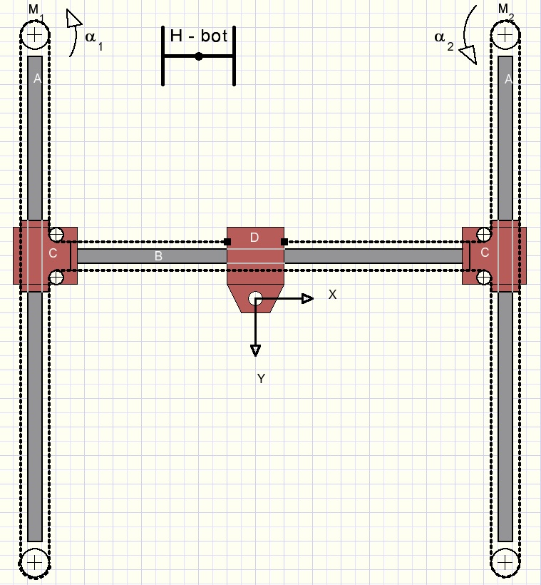
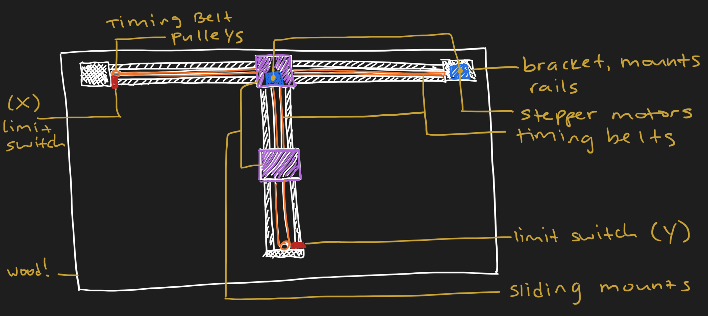
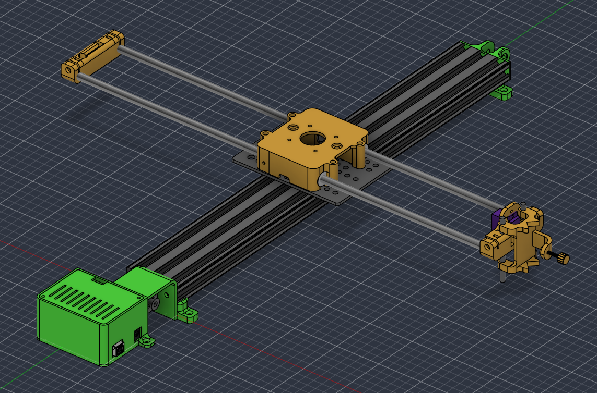

# Assembly Guide
**NOTE -- this guide is in-progress**
## Design Overview
While initially designing V1.0 of Tengwar, I wanted to keep things as light and simple as possible. I considered following an H-bot design:

  

I really liked the H-bot kinetics, but I really didn't want to use *three* different bar fixtures due to the added weight. I ended up finding an alternative, open source design that only uses two, (see [References](#references) for linked Thingiverse files).

<table align="center">
  <tr>
  <td align="center">
       
      <em>Original V1 prototype</em>
    </td>
    <td align="center">
       
      <em>Check out an interactive view <a href="https://a360.co/4dBvp7I">here</a>!</em>
    </td>
  </tr>
</table>

- Cartesian layout
    - The x-axis is a length of **2060 V-slot** extrusion, a **wheeled gantry plate** rides on it, and the y-axis arm is carried on the gantry.
        - The x belt runs over and under the 2060 extrusion, which is why the x-axis uses a larger **30T pulley** and sits slightly raised.
    - Y-axis arm runs on **8 mm rods** with LM8UU bearings.
- The pen gantry uses a SG90 servo, that move vertically on two short **5 mm rods**.

## References
- XY-Plotter STL files (Thingiverse): https://www.thingiverse.com/thing:4200863/files